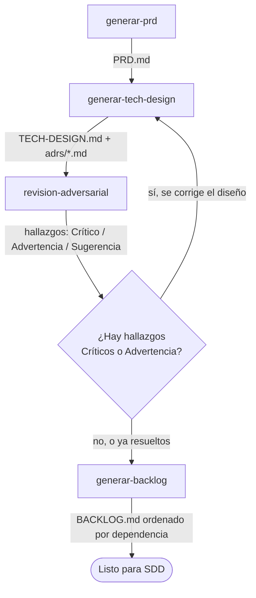
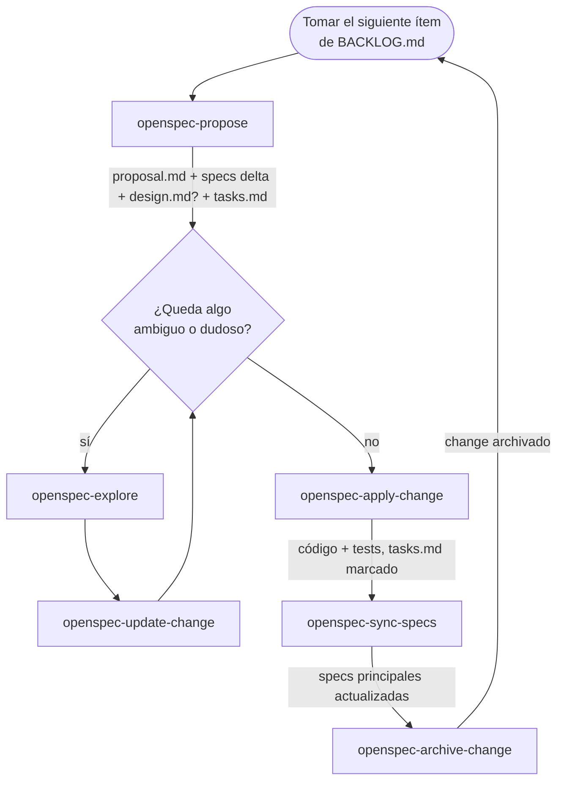

# Flujo de trabajo — CloudCode Skills Registry

Este repo se planifica con un framework de skills propio (PRD → Tech Design → revisión
adversarial → backlog) y se implementa ítem por ítem con OpenSpec (Spec-Driven Development).
Este documento es el mapa de ambos.

## Skills disponibles

| Skill | Qué hace | Cuándo usarla | Cómo se invoca |
|---|---|---|---|
| `generar-prd` | Genera `PRD.md` a partir de una idea de producto | Al arrancar un proyecto o feature grande, antes de diseñar nada técnico | `Skill` tool / `.claude/skills` |
| `generar-tech-design` | Genera `TECH-DESIGN.md` + ADRs (formato MADR) entrevistando decisión por decisión a partir del PRD | Después de tener un PRD aprobado | `Skill` tool / `.claude/skills` |
| `revision-adversarial` | Desafía `TECH-DESIGN.md` y sus ADRs buscando huecos, riesgos y decisiones débiles — nunca valida por defecto | Después de generar el Tech Design, antes de congelarlo. Idealmente en una conversación nueva, sin el historial de cómo se generó | **Manual** — no está enlazada en `.claude/skills` todavía; se sigue leyendo `.agents/skills/revision-adversarial/SKILL.md` a mano |
| `generar-backlog` | Despieza `PRD.md` + `TECH-DESIGN.md` en un backlog ordenado por dependencia, listo para SDD | Con PRD y Tech Design ya aprobados | `Skill` tool / `.claude/skills` |
| `openspec-propose` | Crea un change de OpenSpec con todos sus artefactos (`proposal.md`, specs delta, `design.md` si aplica, `tasks.md`) | Al arrancar un ítem del backlog | `/opsx:propose` |
| `openspec-explore` | Compañero de pensamiento para investigar dudas antes o durante un change, sin comprometerse a un plan | Cuando algo del ítem no está claro antes de proponer o implementar | `/opsx:explore` |
| `openspec-update-change` | Revisa artefactos ya existentes de un change y los mantiene coherentes entre sí | Cuando cambia una decisión a mitad de camino, antes de aplicar | `/opsx:update` |
| `openspec-apply-change` | Implementa las tasks de un change, marcando cada checkbox al completarla | Cuando los artefactos de planificación están listos | `/opsx:apply` |
| `openspec-sync-specs` | Sincroniza la spec delta de un change contra las specs principales, sin archivar todavía | Cuando querés que las specs principales reflejen el cambio antes de cerrar el change | `/opsx:sync` |
| `openspec-archive-change` | Archiva un change completo y actualiza las specs principales | Cuando la implementación y sus tests ya están verificados | `/opsx:archive` |

## Fase 1 — Diseño (una sola vez, antes del backlog)

`revision-adversarial` **reporta, no edita**: el humano decide qué corregir en
`TECH-DESIGN.md`/ADRs antes de pasar a `generar-backlog`.

## Fase 2 — Ciclo SDD por ítem del backlog (se repite por cada fila de `BACKLOG.md`)

`design.md` y las specs delta son condicionales: se saltan explícitamente
(`skip_specs: true`, o instrucción marcada como opcional) cuando el ítem no introduce
comportamiento nuevo del sistema (ej. scaffolding puro) — nunca se inventa una capability para
rellenar el formato.

## Dónde vive cada artefacto

- `PRD.md`, `TECH-DESIGN.md`, `adrs/*.md`, `BACKLOG.md` — raíz del repo, resultado de la Fase 1.
- `openspec/config.yaml` — contexto de proyecto (stack, ADRs) que se inyecta automáticamente en
  cada artefacto de OpenSpec.
- `openspec/changes/<item-del-backlog>/` — planificación SDD de un ítem en curso (`proposal.md`,
  `specs/`, `design.md`, `tasks.md`).
- `openspec/specs/` — specs principales, vivas, actualizadas por `openspec-sync-specs` /
  `openspec-archive-change`.
