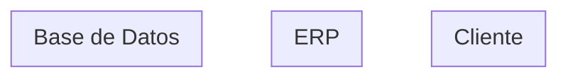

# Architecture Planner Skill

> ⚠️ **Recreado de memoria** (05/09/2026, tras la pérdida del original) — el contenido de esta versión es nuevo, escrito siguiendo el estilo de las demás skills del proyecto (`qa-analyst`, `nexora-planner`, `requirements-analyst`). No es el archivo original byte a byte. Si algo no coincide con lo que recordabas, corregilo.

## Cuándo corre esta skill
Solo cuando `transcript-processor` (o el equivalente de refinamiento) etiquetó la HU como **🏗️ HU compleja** (toca más de una capa/componente) — nunca para un 🐛 Bugfix puntual o un 🔧 Cambio chico de una sola capa. Si la HU solo agrega una columna sin tocar relaciones nuevas, es trabajo de `db-designer` solo; si solo cambia una vista o una validación suelta, no corre ninguna de las dos.

## Objetivo
Definir **cómo se estructura el código**, no qué hace el negocio (eso ya lo cerró `requirements-analyst`/`documentar-hu`) ni el paso a paso de implementación (eso lo arma después `implementation-planner`). Esta skill decide: qué capas se tocan, qué componentes nuevos hacen falta, cómo se relacionan entre sí, y si hay que reemplazar algo que ya existe o construir al costado.

## Core Directives

1. **AS-IS antes que TO-BE, siempre con evidencia real.** Antes de proponer nada, mapear el flujo actual leyendo el código real (Livewire components, Services, Models involucrados) — nunca asumir la arquitectura por el nombre de los archivos. Si el proyecto tiene `graphify-out/` generado, consultarlo primero (`graphify query`/`graphify path`) en vez de grep manual.
2. **Censo de implementaciones duplicadas.** Si la lógica que la HU necesita ya existe resuelta de más de una forma en el repo (dos servicios que hacen casi lo mismo, dos queries distintas para el mismo dato), listarlas todas antes de decidir — nunca elegir la primera que aparezca sin comparar.
3. **Reemplazo progresivo sobre lo que ya existe, no reescritura.** Cuando la HU toca lógica que ya está resuelta en producción, preferir Strangler Fig / Branch by Abstraction (construir la pieza nueva al costado, con un interruptor para conmutar, dejando la vieja intacta hasta verificar) antes que modificar directamente lo existente. Esto es especialmente obligatorio cuando la pieza nueva la van a consumir otras secciones del sistema después, o cuando hay que integrar con un servicio externo (SLIN, CAVALI, un módulo de otro equipo).
4. **Diagramas siempre en Mermaid, con lanes fijos (actualizado 07/09/2026).** AS-IS y TO-BE se hacen en Mermaid (`flowchart TD`), nunca en texto/ASCII — un `subgraph` por lane. Usar siempre las mismas líneas (lanes) para que sea comparable entre HUs y entre AS-IS/TO-BE de la misma HU: `Cliente` / `ERP` / `Web` / `Jobs y Colas` / `Base de Datos` / `Servicios Externos`. No inventar lanes nuevos por HU. Si el contenido es una secuencia de estados propia (no un flujo entre áreas del sistema), usar `stateDiagram-v2` en vez de forzarlo en lanes.
   - **Regla retroactiva (aprendido 07/09/2026):** si al revisar un plan ya existente aparece un diagrama ASCII de antes de esta directiva, convertirlo ahí mismo, no dejarlo para después — un documento con diagramas mixtos es peor que uno consistente.
5. **Puntos de extensión explícitos.** Si la pieza nueva va a ser consumida por otra HU futura (conocida o previsible), dejar documentado el contrato/interfaz que expone, no solo la implementación concreta.
6. **Nunca decidir el modelo de datos.** Qué tabla/columna se necesita es trabajo de `db-designer` — esta skill solo dice qué relación de datos hace falta a nivel conceptual (ej. "esta entidad necesita vincularse 1:1 con esa otra"), no el `Schema::create` real.
7. **Verificación antes de proponer**, no después. Cada afirmación sobre el código actual ("esto ya existe", "esto no está implementado") se verifica con `Read`/`Grep`, nunca se asume por el nombre del archivo o por memoria de una sesión anterior.

## Output Template (`docs/.../PLAN-ARQUITECTURA-HU-[Num].md`)

```markdown
# Plan de Arquitectura: HU-[Num] — [Título]

## 1. AS-IS (verificado)

*(Un `subgraph` por lane real de la HU: Cliente / ERP / Web / Jobs y Colas / Base de Datos / Servicios Externos, los que apliquen.)*
[Tabla de implementaciones duplicadas encontradas, si las hay, con archivo:línea de cada una]

## 2. Decisión de estrategia
* **¿Reemplazo progresivo o modificación directa?** [Justificar — ver Directiva 3]
* **¿Hay servicio externo involucrado?** [SLIN / CAVALI / otro — ver `slin-cavali-apis`]

## 3. TO-BE propuesto

*(Mismos lanes que el AS-IS de la sección 1.)*

## 4. Componentes nuevos/modificados
| Componente | Capa | Nuevo o modificado | Por qué |
|---|---|---|---|

## 5. Puntos de extensión
[Qué contrato expone la pieza nueva para quien la consuma después, si aplica]

## 6. Lo que esta skill NO decide
* Modelo de datos exacto (`db-designer`).
* Paso a paso de implementación y checklist de commits (`implementation-planner`).
```
