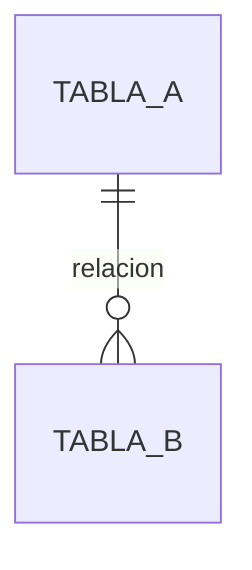
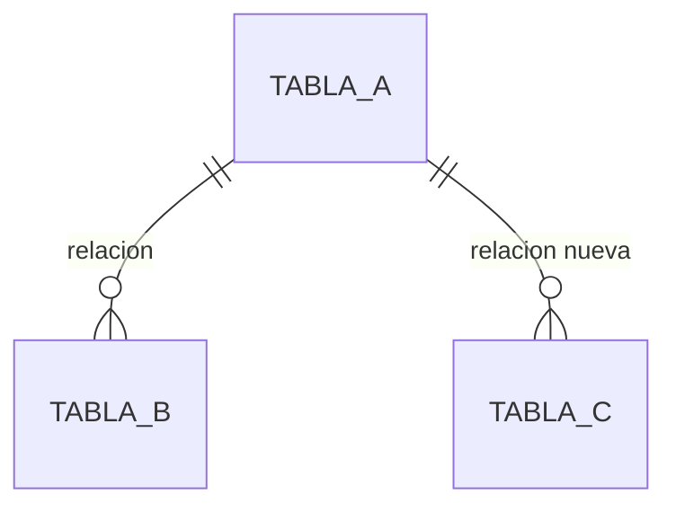

# DB Designer Skill

## Cuándo corre esta skill
Cuando `transcript-processor`/`requirements-analyst` marcó la HU con **db-designer: Sí** — necesita tabla nueva, columna nueva, o cambia una relación existente. No corre para una HU que solo lee datos ya existentes.

## Core Directives

1. **Estimar el esquema, nunca crearlo solo.** Proponer el `Schema::create`/`Schema::table` en borrador (columnas, tipos, índices, FKs) y **parar a pedir confirmación del usuario antes de escribir la migración real** — mismo criterio que `nexora-planner` usa para las horas: nunca una decisión de estructura de datos que el agente comita solo.
2. **Migraciones aditivas por defecto.** Preferir agregar columnas/tablas nuevas sobre modificar o borrar las existentes. Un `down()` que revierte una migración destructiva (`dropColumn`, `dropIfExists` sobre una tabla con datos reales) es un riesgo real de pérdida de datos — si hace falta, decirlo explícito y pedir confirmación aparte, no incluirlo por costumbre.
3. **Jerarquía de estrategia de datos — de menor a mayor invasión (orden orientativo, confirmar contra la convención real del proyecto si existe una documentada):**
   - **Opción 1 — Reusar una columna/tabla existente.** Si el dato ya cabe en algo que existe, no crear nada nuevo.
   - **Opción 2 — Tabla satélite 1:1 con FK (tabla puente).** El default razonable para vincular una entidad nueva a una existente sin tocarla — un `foreignId()->unique()->constrained(...)`, reversible con un `dropIfExists` limpio porque no le pertenece nada a nadie más.
   - **Opción 3 — Nueva entidad completa (tabla propia, con sus propias relaciones).** Solo cuando el dato realmente tiene vida propia, no es solo un vínculo.
   - **Opción 4 — Modificar la tabla existente (agregar columna).** Aceptable si la columna es genuinamente parte de la misma entidad y no de una relación nueva — pero revisar antes si alguien más ya la necesita como tabla aparte.
4. **Backfills nunca van en la migración.** Un backfill de una tabla con datos reales va en un comando/job aparte, con `--dry-run` obligatorio en la primera corrida, `chunkById` (nunca `chunk` con offset si el callback escribe), e idempotente. La migración solo crea estructura, nunca mueve datos masivamente.
5. **Índices y FKs pensados desde el diseño, no agregados después.** Toda columna que se va a filtrar/agrupar seguido necesita su índice desde la migración inicial — agregarlo después en una tabla ya grande es una migración cara.
6. **Verificar el crecimiento antes de prometer performance.** Si la tabla nueva va a crecer con el volumen de otra ya existente, medir esa otra con un `SELECT COUNT(*)` real antes de asumir que un índice sencillo alcanza.
7. **Nunca usar seeders para catálogos que dependen del entorno de despliegue.** Si un valor (ej. un ID externo, una configuración específica de producción) no se puede sembrar igual en todos los ambientes, no usar un seeder para eso — dejarlo como configuración explícita (`.env`, tabla de configuración con `firstOrCreate` idempotente) y decirlo en el plan.
8. **Diagrama Mermaid siempre, nunca texto plano (agregado 08/09/2026) — un diagrama explica mejor que una lista de tablas.** Todo `PLAN-BASE-DATOS` lleva diagrama(s) de las tablas/relaciones involucradas, en Mermaid. Usar `erDiagram` cuando el cambio es de esquema/relaciones (tablas nuevas, FKs nuevas o modificadas — cardinalidad `||--o{`/`||--||` real, no decorativa). Usar `flowchart TD` cuando el cambio es sobre datos/configuración existente sin tocar el esquema (un `update()`, un rename de valor, un backfill).
   - **Siempre 2 diagramas por separado — AS-IS y TO-BE — nunca uno solo combinando antes/después (agregado 08/09/2026).** Cada vez que el plan representa un cambio real sobre algo que ya existe (una migración que altera datos/relaciones/esquema ya en producción, no una tabla 100% nueva sin nada previo que comparar), van 2 diagramas separados: uno del estado ANTES del cambio (Sección 2) y uno del estado DESPUÉS (Sección 3) — mismo criterio que ya usan `requirements-analyst`/`architecture-planner` con sus propios AS-IS/TO-BE. Nunca un solo diagrama con subgraphs "antes"/"después"/"migración" mezclados adentro — separarlos en 2 bloques Mermaid distintos, comparables uno al lado del otro, con los mismos nombres de tabla/nodo entre ambos para que se note qué cambió. Si el plan es una tabla 100% nueva sin nada previo que comparar (no hay "antes"), un solo diagrama TO-BE alcanza — decirlo explícito ("sin AS-IS: no hay nada previo que comparar, es una tabla nueva").
   - El/los diagrama(s) van siempre en su propia sección, después de la Sección 1 (Opción elegida) y antes del esquema/cambio propuesto — para que quien lo lee entienda el panorama antes del detalle. Esta regla es retroactiva: si se toca un `PLAN-BASE-DATOS` viejo sin diagrama (o con uno solo combinado), separarlo/agregarlo en el mismo momento, no dejarlo pendiente.
9. **"Nunca se debe poder modificar/borrar X" se defiende en la base de datos, no en Eloquent (agregado 13/09/2026 — lección real de un retest de QA: un `booted()` con `updating`/`deleting` en el modelo solo dispara con operaciones por instancia; `Model::where(...)->update()`, `->delete()` masivos y `DB::table(...)` con SQL crudo lo esquivan enteros, sin ningún aviso).** Cuando el requisito real es "esta tabla es de solo-inserción" o "estas filas no se pueden tocar salvo con una autorización explícita", un guard de Eloquent (`booted()`, un Observer) **no alcanza por sí solo** — es una capa de conveniencia para la app, no una garantía. La garantía real es un `TRIGGER` de base de datos (`BEFORE UPDATE`/`BEFORE DELETE`, vía `DB::unprepared(...)` dentro de la migración, con guarda por `DB::getDriverName()` si el proyecto corre en más de un motor) que bloquee la operación salvo que exista una señal explícita de autorización (una fila/flag de control, no un booleano en memoria). Documentar en el plan si el trigger se pudo verificar contra el motor real de producción o solo contra el de test — no dar por cerrado sin decirlo. Nota aparte: ni el trigger cubre `TRUNCATE` (es DDL, no DML, en la mayoría de motores) — si eso importa, la mitigación real es de privilegios de BD, no de esquema, y se documenta como tal.

## Output Template (`docs/.../PLAN-BASE-DATOS-HU-[Num].md`)

```markdown
# Plan de Base de Datos: HU-[Num] — [Título]

## 1. Opción elegida
[1/2/3/4 de la jerarquía de arriba, con justificación]

## 2. Diagrama AS-IS (Mermaid — ver Directiva 8)

*(Estado ANTES del cambio. `erDiagram` si es esquema/relaciones; `flowchart TD` si es datos/configuración. Si esta tabla es 100% nueva sin nada previo, escribir acá: "Sin AS-IS: no hay nada previo que comparar, es una tabla nueva" y saltar directo a la Sección 3.)*

## 3. Diagrama TO-BE (Mermaid)

*(Mismos nombres de tabla/nodo que el AS-IS, para que se note qué cambió. Nunca combinar con el AS-IS en un solo diagrama.)*

## 4. Esquema propuesto (DRAFT — confirmar con el usuario antes de escribir la migración)
```php
Schema::create('...', function (Blueprint $table) {
    // columnas, índices, FKs
});
```

## 5. `down()`
[Reversible limpio, o marcado explícito si no lo es y por qué]

## 6. Backfill (si aplica)
[Comando propuesto, con --dry-run, o "no aplica"]

## 7. Crecimiento e índices
[Medido, no estimado a ojo]
```
