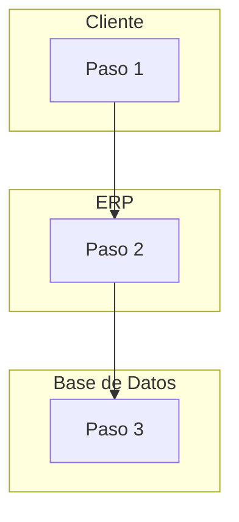
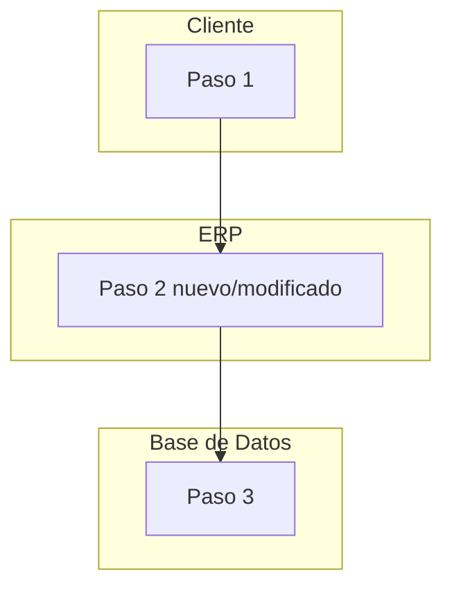

# Requirements Analyst Skill (No-Assumptions & Standard Layout Mode)

This skill guides the agent in running a thorough, interactive requirements analysis and documenting it using a highly structured, standard 7-section layout focused strictly on requirements, dependencies, architectural layer tagging, UI screen scope, URLs, and domain analysis (excluding deployment guides).

## Core Directives
1. **Never Assume:** If a business rule, limit, workflow trigger, or configuration is not explicitly documented, do not guess it. Mark it as "Unresolved Decision" and ask the user first.
2. **Standard 7-Section Layout:** All requirement plans and specifications generated for a User Story (HU) must follow the exact 7-section structure defined in the template.
3. **Explicit Architectural Layer Tagging per Requirement (`[Capas Afectadas]`):** Specify the exact layer affected:
   - `[🎨 UI / UX]` (Interacciones visuales, diseño responsive, alertas)
   - `[💻 Frontend / Blade]` (Vistas Blade, componentes UI, copy estático)
   - `[⚙️ Backend / Logic]` (Componentes Livewire, Controllers, Services, Jobs)
   - `[🗄️ Base de Datos / Migration]` (Modelos Eloquent, Migraciones, Tablas)
   - `[🧪 Testing / PHPUnit]` (Pruebas unitarias e integración)
4. **Strict UI Copy Boundary Directive (Regla de oro: Copy UI vs Backend/BD):**
   Changes like replacing `"Lote"` with `"Terreno"`, `"comprobante"` with `"Voucher"`, or `"ASBANC"` with `"ASBAN"` apply **EXCLUSIVELY TO USER-FACING UI/UX COPY** in Blade templates (`resources/views/livewire/...blade.php`).
   **PROHIBITED:** Never rename Eloquent models (`Lote.php`), DB tables (`slin_lote_cache`), database columns (`slin_asbanc`), controller classes, or PHP internal variables (`$lote`). Include explicit warning: *"⚠️ Modificar ÚNICAMENTE la capa [🎨 UI / UX]. PROHIBIDO alterar la capa [⚙️ Backend / Base de Datos / Modelos]"*.
5. **Mandatory Screen Scope & URL Metadata (🌐 Enfoque de Pantalla, URL y Modales):** Every requirement plan MUST include explicit metadata detailing:
   - **Ruta / URL Afectada:** e.g. `/erp/solicitud-evidencia-pago/{id}/editar` or `/mi-portal/lotes/{id}`
   - **Enfoque de Pantalla Afectada (Focus Scope):** Explicitly clarify which screen is modified and which screen is NOT touched.
   - **Componente / Modal Específico:** Exact modal name (e.g. `ModalConfirmacionCierre`, `AdjuntarVoucherPago`).
6. **Mandatory Dependencies Section:** Every requirement plan MUST include the **🔗 Apartado de Dependencias y Bloqueos** inside Section 1 (Resumen Ejecutivo).
7. **Structured Visual Comparison — Mermaid, siempre, con lanes por área (actualizado 07/09/2026):** Los diagramas AS-IS y TO-BE se hacen **en Mermaid** (`flowchart TD`, flujo vertical), nunca en texto plano/ASCII. Cada actor o área que participa (Cliente, ERP, Web, Jobs y Colas, Base de Datos, Servicios Externos, u otras según la HU) va en su propio `subgraph` — es el diagrama de "cuadrado con flechas verticales por área": un cuadro (lane) por parte del sistema, con el flujo bajando dentro de cada uno y flechas cruzando entre lanes cuando el proceso pasa de un área a otra. Usar siempre los mismos nombres de lane entre el AS-IS y el TO-BE de una misma HU, para que sean comparables. Cuando el contenido es literalmente una secuencia de estados (un ciclo de vida, un conjunto de estados propio) en vez de un flujo entre áreas del sistema, usar `stateDiagram-v2` en lugar de forzarlo en lanes — el criterio es el mismo (Mermaid siempre, nunca ASCII), la elección de tipo de diagrama depende del contenido. Tablas para fricciones y valor agregado, como ya se hacía.
   - **Esta regla es retroactiva, no solo para documentos nuevos (aprendido 07/09/2026):** si al tocar o revisar un plan ya existente aparece un diagrama en texto/ASCII de una versión anterior (de antes de esta directiva, o de un documento que se saltó la conversión), convertirlo a Mermaid en el mismo momento, no dejarlo "para después" — un documento con diagramas mixtos (unos Mermaid, otros ASCII) es peor que uno consistente, y el usuario no debería tener que pedirlo de nuevo archivo por archivo.
8. **NO DEPLOYMENT GUIDES:** Never include deployment steps or release sections in requirement plans.
9. **Causa raíz antes de proponer nada (5 porqués, agregado 07/09/2026):** En la Sección 3 (Situación del problema), antes de escribir "Propuestas de solución" en la Sección 4, encadenar **"¿por qué?" cinco veces** partiendo de la fricción observada, hasta llegar a una causa que ya no admite otro "¿por qué?" útil (un límite técnico real, una decisión de negocio tomada, o la ausencia de algo que nunca se construyó) — nunca quedarse en el primer síntoma. El impacto de esa causa raíz se cuantifica con un número real (verificado en código/BD/logs) o se marca explícito `[A ESTIMAR]` con la forma concreta de medirlo — nunca una estimación inventada a ojo. Esta cadena de 5 porqués NO propone solución todavía (eso es la Sección 4/5) — mezclar diagnóstico y solución en el mismo paso hace que nadie cuestione el diagnóstico.
10. **Core Journey (in-scope) y Fuera de Alcance decidido, separados de las preguntas pendientes (agregado 16/09/2026):** "Decisión de Alcance" (Sección 1) no puede quedar en una sola frase suelta — debe declarar explícito el **`🎯 Core Journey (In-Scope)`**: el camino feliz concreto que esta HU sí construye, en 2-4 líneas o un Gherkin corto, citando la pantalla/acción real (nunca una descripción genérica tipo "mejorar el módulo"). Simétricamente, la Sección 7 deja de tener un solo bloque de "alcance no cubierto" y se divide en **tres** bloques que nunca se mezclan entre sí:
    - `🔒 Reglas Mandatorias Aprobadas` — lo que sí se decidió hacer.
    - `🚫 Fuera de Alcance (Decidido — Anti Scope-Creep)` — cosas adyacentes que se consideraron y se **descartaron a propósito** para esta HU. Es un límite firme, no una duda: sirve para que alguien que toque esta HU después (o un revisor de PR) pueda citar "esto se decidió no hacer acá" en vez de adivinar o colar trabajo no pedido.
    - `❓ Consultas Pendientes de Definición por la PO` — lo que de verdad sigue sin resolverse (a diferencia del bloque anterior, esto todavía puede cambiar cuando la PO responda).
    Nunca poner un ítem "no lo vamos a hacer porque no nos dijeron" bajo Fuera de Alcance si en realidad es una pregunta sin responder — eso va en Consultas Pendientes. El Core Journey y el bloque de Fuera de Alcance son lo que `implementation-planner` y la skill `success-criteria-planner` heredan tal cual (ver Directiva 4 de `implementation-planner` y Directiva 2 de `success-criteria-planner`) — no se redefinen en esos documentos posteriores.

---

## Output Specifications Template (`PLAN-REQUERIMIENTOS-HU-[Num].md`)

Every requirement plan document must contain exactly these 7 sections:

```markdown
# Plan de Requerimientos: HU-[Num] — [Title]

**Módulo:** [Module Name]  
**🌐 Enfoque de Pantalla:** [Pantalla exacta que afecta vs las que NO afecta]  
**🔗 Ruta / URL:** `[e.g. /erp/solicitud-evidencia-pago/{id}/editar]`  
**🖼️ Modal / Componente:** `[e.g. ModalConfirmacionCierre / AdjuntarVoucherPago]`  
**Dependencias Bloqueantes:** [Blocking HUs / External APIs]  
**Dependencias No Bloqueantes:** [Non-blocking relationships]  
**Fecha:** [Date]  
**Estado:** 🟡 [Current UX/UI Analysis state]  

---

## 1. 🎯 Resumen Ejecutivo
* **Pedido de negocio (PO Quote):** Direct quotes from business/PO regarding the UX/functional friction.
* **Contexto Técnico:** Summary of why we are re-analyzing this HU.
* **🎯 Core Journey (In-Scope):** El camino feliz concreto que esta HU construye — 2-4 líneas o Gherkin corto, citando pantalla/acción real. Esto es lo que `implementation-planner` y `success-criteria-planner` heredan como criterio central (ver Directiva 10).
* **🌐 Enfoque de Pantalla y Contexto UI:**
  - **Pantalla Afectada:** [Ej. Edición de Solicitud SolicitudEvidenciaPagoEditar]
  - **Pantallas NO Afectadas:** [Ej. NO modifica la tabla de lista principal solicitud-evidencia-pago-lista]
  - **Ruta / URL:** `[e.g. /erp/solicitud-evidencia-pago/{id}/editar]`
  - **Modal / Componente UI:** `[e.g. ModalConfirmacionCierre]`
* **🔗 Apartado de Dependencias y Bloqueos:**
  - **Dependencias Bloqueantes:** [HUs previas o APIs indispensables]
  - **Dependencias No Bloqueantes:** [Módulos o servicios relacionados]
  - **Bloqueos Funcionales / Negocio:** [Definiciones pendientes de PO]

## 2. 🏗️ Diagrama AS-IS (Flujo Actual)

*(Un `subgraph` por área/actor real de la HU — Cliente/ERP/Web/Jobs y Colas/Base de Datos/Servicios Externos, los que apliquen. Mismos nombres de lane que en el TO-BE de la sección 5.)*
* **Fricciones detectadas:** Table listing:
  | # | Dónde | Qué pasa (Fricción real verificada en código) |
  |---|---|---|

## 3. 📉 Situación del problema
* **Origen de negocio:** Detailed explanation of the business necessity.
* **Causa raíz (5 porqués — ver Directiva 9, sin proponer solución todavía):**
  1. ¿Por qué...? [respuesta 1]
  2. ¿Por qué [respuesta 1]...? [respuesta 2]
  3. ¿Por qué [respuesta 2]...? [respuesta 3]
  4. ¿Por qué [respuesta 3]...? [respuesta 4]
  5. ¿Por qué [respuesta 4]...? **[causa raíz — límite técnico real / decisión de negocio / ausencia confirmada en código]**
  * **Impacto medido:** [número real, con cómo se obtuvo] o `[A ESTIMAR]` + [forma concreta de medirlo]
* **Fricciones vs. Código Actual:**
  | Fricción del Análisis Previo | Estado Hoy |
  |---|---|
  | [Friction point] | 🔴 Sigue vigente / 🟢 Resuelto |

## 4. 💡 Propuestas de solución y oportunidades de mejora
* **Patrón de diseño de referencia:** Existing patterns or modules in the system to reuse.
* **Rediseño propuesto:** Specific UX/backend modifications to build.
* **Puntos de extensión:** slots or areas reserved in the UI.

## 5. 🏗️ Documentación TO-BE (Flujo Propuesto)

*(Mismos lanes/nombres que el AS-IS de la sección 2, para que se note qué cambió.)*

## 6. 💰 Valor agregado
| Antes (AS-IS) | Después (TO-BE) |
|---|---|
| [Current limitation] | [Proposed improvement] |

## 7. 📌 Alcance no cubierto y Reglas del Proyecto

### 🔒 Reglas Mandatorias Aprobadas (Innegociables)
- [Explicit approved business & UI rules]

### 🚫 Fuera de Alcance (Decidido — Anti Scope-Creep)
- [Algo adyacente que se consideró y se descartó a propósito para esta HU — un límite firme, no una duda. Nunca poner acá una pregunta sin responder.]

### ❓ Consultas Pendientes de Definición por la PO (Rosario)
- [Explicit unresolved questions — a diferencia del bloque anterior, esto todavía puede cambiar]
```
